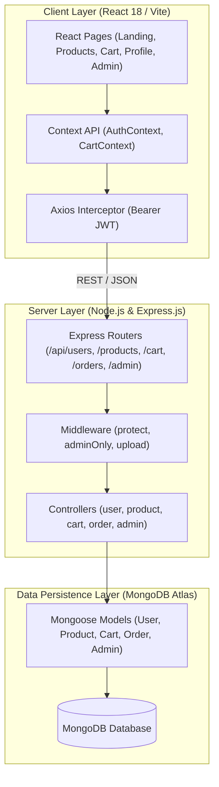

# Project Design Phase: Solution Architecture

| Meta Attribute | Value |
| :--- | :--- |
| **Date** | 12 August 2026 |
| **Team ID** | N/A |
| **Project Name** | ShopEZ Ecommerce Application |
| **Author / Repo** | Aditya Kamble ([https://github.com/Aditya-Kambale/ShopEZ_MERN_Stack](https://github.com/Aditya-Kambale/ShopEZ_MERN_Stack)) |
| **Maximum Marks** | 4 Marks |

---

## 1. High-Level Architecture
ShopEZ implements a 3-tier layered architecture adhering to the Model-View-Controller (MVC) pattern.

